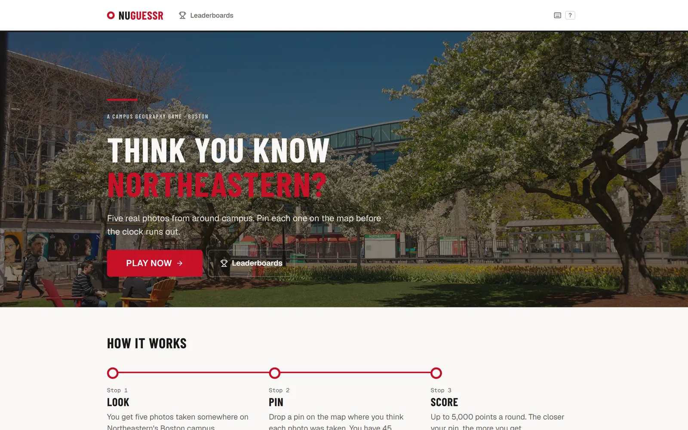
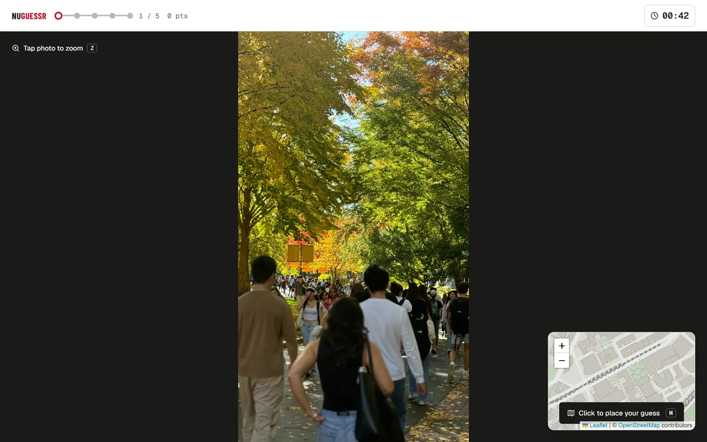
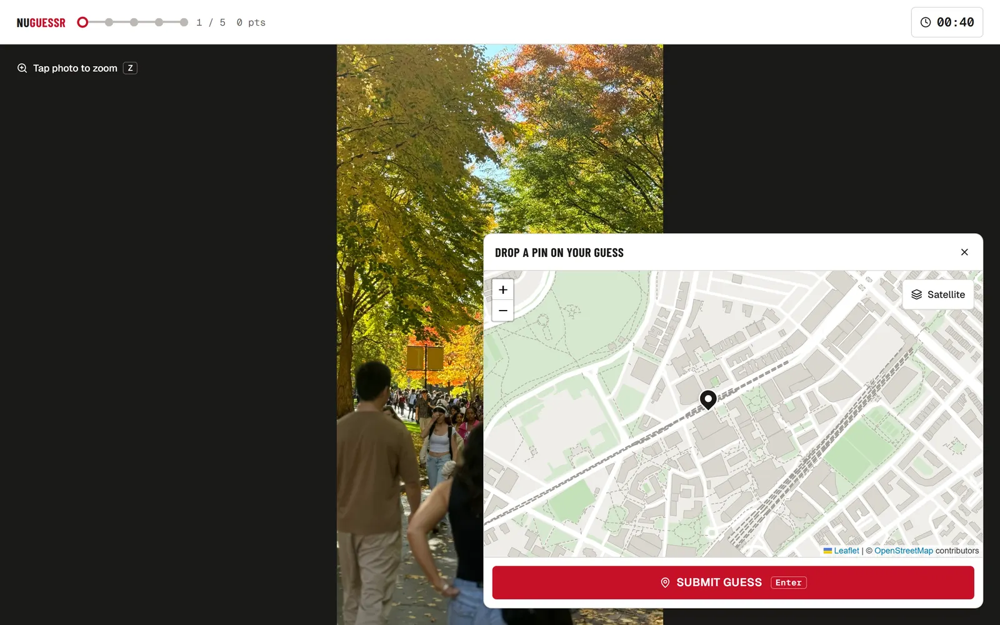
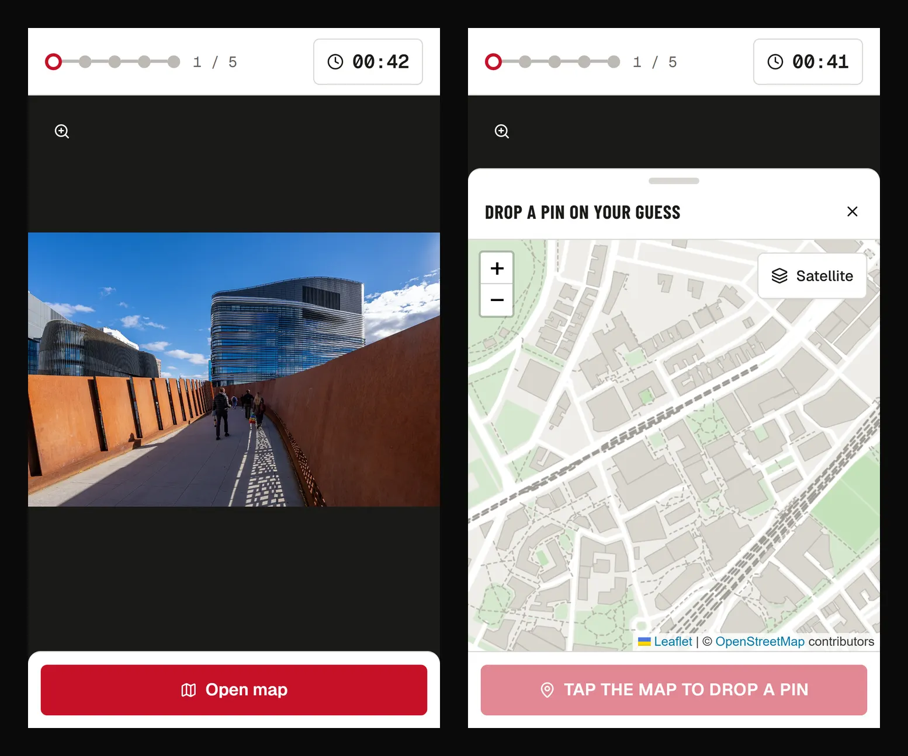
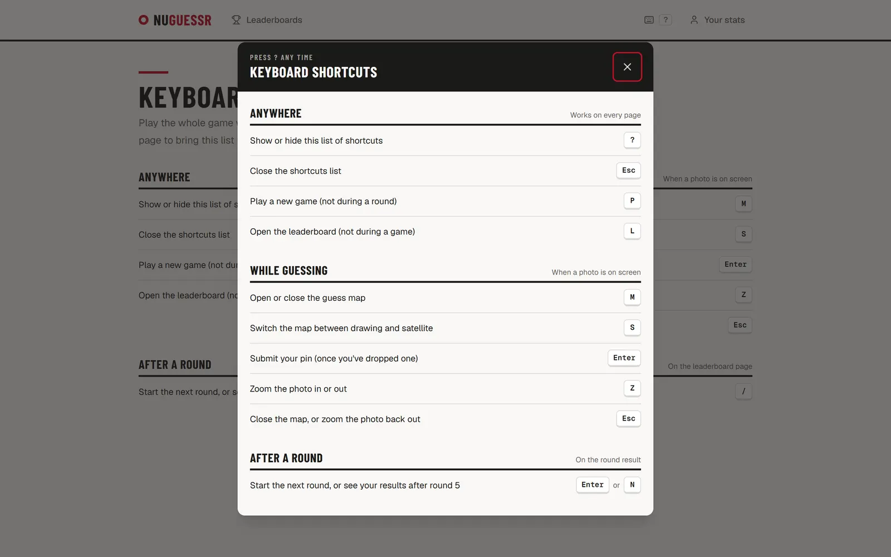
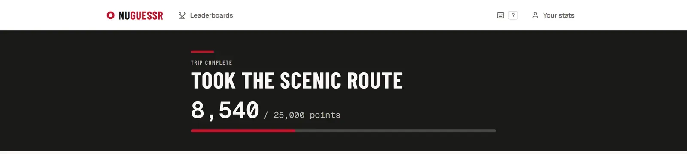
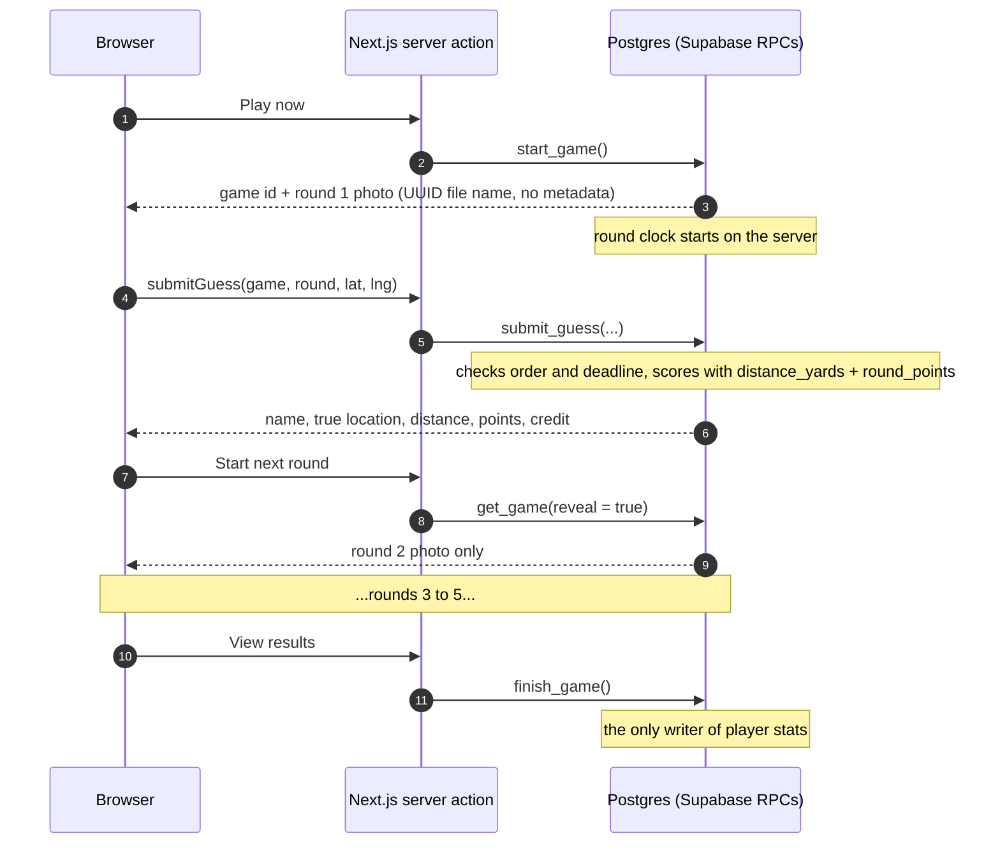
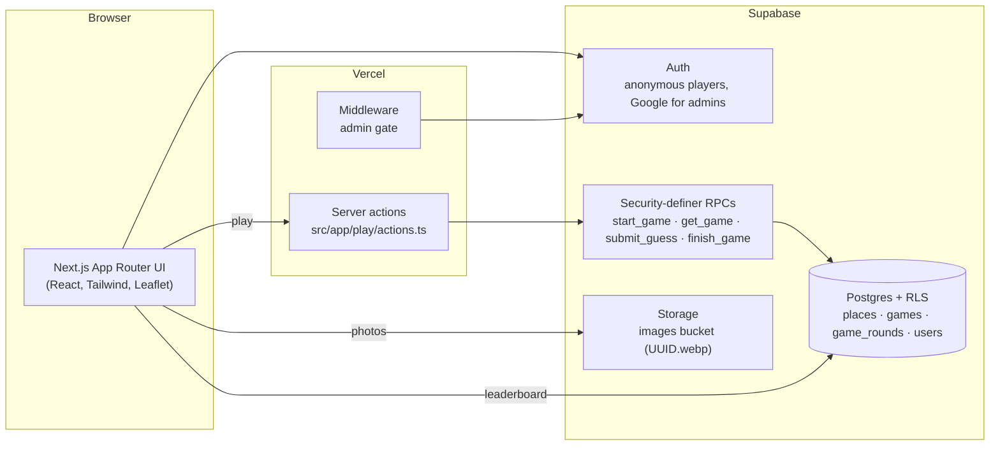
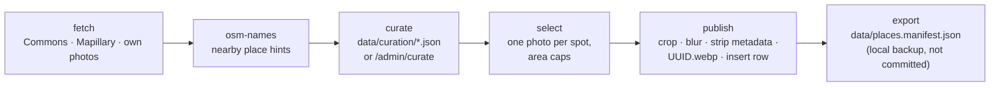

<div align="center">

# NUGuessr

**A GeoGuessr-style game for Northeastern University's Boston campus.**<br>
Five real campus photos. 45 seconds each. Drop a pin, score by distance.

[](https://www.mehr-anand.com/nuguessr)




</div>

> **This is a community fork.** The original NUGuessr was built by **Philip Elbert, Joshua Chan, Oscar Ji, and Alan Tai** for HackBeanpot 2025, where it won "First Pit Stop - Best Beginner." This fork polishes and finishes several things the original Devpost submission called out as still in progress (see [Changes in this fork](#changes-in-this-fork)). All credit for the original concept, design, and build goes to that team.

Maintained by Mehr Anand ([@mesanand](https://github.com/mesanand)). Live at <https://www.mehr-anand.com/nuguessr>.

> **Where it runs now.** The game is played at **[mehr-anand.com/nuguessr](https://www.mehr-anand.com/nuguessr)**. Its front end lives in [mesanand/portfolio](https://github.com/mesanand/portfolio) under `src/nuguessr/` (a second Vite page that calls the same database functions). This repo keeps the original Next.js app, the database migrations, the security tests and the photo pipeline, and it's no longer deployed on its own.

<table>
<tr>
<td align="center" width="50%"><b>Find the spot</b><br><sub>Real photo, server-run clock, tap to zoom</sub></td>
<td align="center" width="50%"><b>Drop your pin</b><br><sub>Label-free campus map, satellite toggle</sub></td>
</tr>
<tr>
<td></td>
<td></td>
</tr>
<tr>
<td align="center"><b>Built for phones</b><br><sub>Bottom-sheet map, 44 px touch targets</sub></td>
<td align="center"><b>Keyboard-first on desktop</b><br><sub>Press <kbd>?</kbd> anywhere</sub></td>
</tr>
<tr>
<td></td>
<td></td>
</tr>
</table>

<p align="center"></p>

## Contents

- [How to play](#how-to-play)
- [Features](#features)
- [How a round works](#how-a-round-works)
- [Fair play and security](#fair-play-and-security)
- [Architecture](#architecture)
- [Running it yourself](#running-it-yourself)
- [Photo pipeline](#photo-pipeline)
- [Testing](#testing)
- [Project structure](#project-structure)
- [Attribution and licensing](#attribution-and-licensing)
- [Changes in this fork](#changes-in-this-fork)

## How to play

| | |
|---|---|
| **1. Look** | You get five photos taken somewhere on campus, one at a time. Each round has a 45-second clock. |
| **2. Pin** | Open the map and drop a pin where you think the photographer stood. Switch to satellite if it helps. |
| **3. Score** | Up to **5,000 points** a round: full marks within 12 yards, falling to 0 at 500 yards. A perfect game is **25,000**. |
| **4. Sign the board** | No account needed. After a game, type any name to put your best score on the leaderboard. |

## Features

**The game**
- **51 real campus photos.** Freely licensed shots from Wikimedia Commons plus the maintainer's own, each reviewed at full resolution so nothing in the frame names the place. Signs, nameplates and faces are blurred where needed.
- **Label-free guess map.** A self-drawn campus basemap from OpenStreetMap geometry (buildings, paths, green space, and no names) with a satellite toggle, locked to campus.
- **Transit-map design.** Rounds are stops on a line; the result screen is a station sign; the leaderboard is a departures board.
- **Results that teach.** After each guess: the place name, both pins with a dashed line between them, the distance, your points and the photo credit.
- **Spoiler-free sharing.** The summary copies a score card like `●—◐—○—●—◐` with no place names.

**The experience**
- **Tap to zoom** on the photo (2.5×, pans with the mouse).
- **Keyboard shortcuts** for the whole game: <kbd>M</kbd> map, <kbd>S</kbd> satellite, <kbd>Enter</kbd> submit, <kbd>Z</kbd> zoom, <kbd>N</kbd> next round, <kbd>?</kbd> list. Full list at [`/shortcuts`](https://www.mehr-anand.com/nuguessr/shortcuts).
- **Lit podium** for the top three on the leaderboard (twinkling bulbs and sweeping spotlights, still for people who prefer reduced motion), with your own row tagged "You".
- **Phone-first.** Bottom-sheet map, large touch targets, outside-tap to close.

**Under the hood**
- **Every game is recorded and scored in Postgres.** The browser never computes a score and never sees an answer before guessing.
- **No sign-in for players.** Each browser gets a silent Supabase anonymous account, so stats still work without collecting anything.
- **Admin curation tool** at `/admin/curate`: keyboard review, a draggable pin, approve and publish.

## How a round works

The answer only leaves the database after the guess is in.



## Fair play and security

| Threat | What stops it |
|---|---|
| Reading the answer from the page or network | Rounds expose only a UUID-named image. Names, coordinates and notes come back only from `submit_guess`. Clients can't `select` the `places` table at all. |
| Reading the GPS from the photo | Every published image is re-encoded to WebP with **all** metadata stripped (EXIF, GPS, XMP, IPTC, ICC). A security test downloads published images and checks. |
| Peeking at future rounds | Photos are revealed one round at a time. Reloading a result page is read-only and doesn't start the next clock. |
| Taking longer than 45 seconds | The deadline lives in the database (45 s + 10 s network grace). Late guesses score 0. |
| Editing your own score or role | Players can update only their leaderboard name. Stats are written only by `finish_game`; `role` isn't client-writable. |
| Double submits and replays | Rounds must be submitted in order, once each; nothing is accepted after a game is finished. |
| Spamming games | Per-player locks and hourly caps, plus a global cap and cleanup for guest games. |

Run the checks yourself against any deployment with the public key:

```bash
npx tsx --env-file=.env.local tests/security/game-security.ts --expect-locked --check-images 5
```

**Known limitation.** With 51 photos at stable public URLs, a determined script could collect the answer key by playing many games and then post a perfect leaderboard score. Casual players can't see answers early. The real fix is serving photos per game from a private bucket and growing the pool; it's the top item on the roadmap.

## Architecture



| Piece | Where | Notes |
|---|---|---|
| Game logic and scoring | `supabase/migrations/*real_places_and_server_games.sql` | Security-definer RPCs with `search_path = ''`; scoring is `distance_yards` + `round_points` in SQL. |
| Server actions | `src/app/play/actions.ts` | Thin wrappers that call the RPCs with the player's session and never pass raw database errors to the browser. |
| Game UI | `src/components/game/`, `src/components/map-result.tsx`, `src/app/play/[gameId]/` | Leaflet loads client-only (`next/dynamic`, `ssr: false`). |
| Players | `src/lib/player.ts` | Anonymous Supabase sign-in before each game; the leaderboard name lives in `users.username`. |
| Guess map basemap | `public/map/campus-basemap.json` | OSM geometry with no names or tags, built by `scripts/places/build-basemap.ts`. Satellite: Esri World Imagery. |
| Admin | `/admin`, `/admin/curate` | Gated in middleware, in each page and in every server action via `is_admin()`. |
| Shortcuts | `src/lib/shortcuts.ts` | One list drives the handlers, the <kbd>?</kbd> overlay and `/shortcuts`. |

No service-role key is used at runtime: players go through RPCs, and admins write through RLS policies with their own session.

### Tech stack

| Layer | Tools |
|---|---|
| Frontend | Next.js 15 (App Router), React 19, TypeScript, Tailwind CSS 3, shadcn/ui (Radix), Lucide icons |
| Maps | Leaflet with react-leaflet 5, a self-drawn OpenStreetMap basemap, Esri World Imagery |
| Backend | Supabase: Postgres, row-level security, security-definer RPCs, Auth (anonymous plus Google), Storage |
| Photo pipeline | Node and tsx scripts, sharp (resize, crop, blur, metadata stripping), exifr, Overpass API |
| Testing | Playwright (desktop and mobile end-to-end), a security suite run against live databases |
| Hosting | Vercel, as part of mehr-anand.com (front end in the portfolio repo) |

## Running it yourself

1. **Create a Supabase project** at [supabase.com](https://supabase.com), or run one locally with `npx supabase start` (Docker), which applies `supabase/migrations/` automatically.
2. **Apply the migrations** in `supabase/migrations/` in order (`npx supabase db push`, or paste them into the SQL editor).
3. **Turn on anonymous sign-ins**: Authentication → Sign In / Providers → *Allow anonymous sign-ins*. Players need this to get on the leaderboard. Enabling CAPTCHA for it is recommended.
4. **Optional, for admins:** enable the Google provider so you can sign in at `/signin` and reach `/admin/curate`.
5. **Configure env:** copy `.env.example` to `.env.local` and fill in the URL and anon key. Add `SUPABASE_SERVICE_ROLE_KEY` only if you'll run the photo pipeline; it never goes to Vercel.
6. **Publish places** (see [Photo pipeline](#photo-pipeline)), then run `supabase/cutover/20261120000002_cutover_lock_places.sql` once at least 30 have coordinates. It deletes placeholders and locks client reads of `places`.
7. **Start it:**
   ```bash
   npm install
   npm run dev
   ```

Make yourself an admin after signing in once:

```sql
update public.users set role = 'admin' where email = 'you@example.com';
```

### Scripts

| Command | What it does |
|---|---|
| `npm run dev` / `build` / `start` | Next.js dev server, production build, production server |
| `npm run lint` / `typecheck` | ESLint and `tsc --noEmit` |
| `npm run test:e2e` | Playwright on desktop and mobile; set `E2E_BASE_URL` to test a deployment |
| `npm run places:*` | Photo pipeline steps (below) |
| `npm run readme:shots` | Regenerates the screenshots in this README from the live site |

## Photo pipeline

Only sources that grant reuse **and** give real coordinates are used: Wikimedia Commons, Mapillary and your own photos. Never Google Maps or Street View, Northeastern's websites, news sites or social media.



```bash
npm run places:fetch:commons     # Wikimedia Commons geosearch -> data/candidates.json
npm run places:fetch:mapillary   # Mapillary street-level photos (needs MAPILLARY_TOKEN)
npm run places:fetch:own         # your own photos from data/own/ (JPEG/HEIC with GPS)
npm run places:names             # suggest names from nearby OpenStreetMap features
npm run places:coverage          # candidate counts per campus area
npx tsx scripts/places/select.ts # curation decisions -> data/selected.json
npm run places:publish           # strip metadata, resize, upload <uuid>.webp, insert places rows
npm run places:export            # back up published places to data/places.manifest.json (git-ignored: it's the answer key)
npx tsx scripts/places/build-basemap.ts   # rebuild the label-free guess-map basemap
```

**Curation.** Each photo is checked by eye at full resolution: an outdoor campus scene, sharp, recognizable, the pin plausibly where the camera stood, and **no readable text naming the place**. A sign that's unreadable in a 960 px thumbnail can be readable at 1920 px. Decisions live in `data/curation/`: `batch-*` first pass, `rescue-*` crops that cut a sign out, `review-*` final overrides with optional blur boxes. `select.ts` keeps one photo per spot and caps each area, so no corner of campus dominates.

**Publishing** (`src/lib/publish-image.ts`): auto-rotate, optional crop and blur, resize to at most 2000 px, WebP q82, and all metadata removed. Files get random UUID names. The script is idempotent and polite to Wikimedia (standard thumbnail sizes, rate limits, a descriptive User-Agent).

### Adding your own photos

1. Take photos outdoors on campus with location services on. The GPS in the photo becomes the answer, so stand where you want the pin.
2. Copy the **original** files into `data/own/` (AirDrop with *Location* on, or copy from the phone over USB; photos pasted into chats lose their GPS).
3. Run `OWN_PHOTO_AUTHOR="Your Name" npm run places:fetch:own`.
4. Review them (a `data/curation/review-*.json` file or `/admin/curate`), then run `npx tsx scripts/places/select.ts` and `npm run places:publish`.

Own photos are credited by name only: "Photo: Your Name", plus "(text blurred)" where something was blurred.

## Testing

```bash
npm run test:e2e                                    # full games on desktop (1366×860) and mobile (390×844)
npx tsx tests/security/game-security.ts --expect-locked --check-images 5
npx tsx tests/security/signed-in.ts                 # local stack only: stats and role checks
```

The end-to-end suite plays complete games, including a timed-out round and a mid-round reload. Before each guess it asserts that nothing in the DOM, the page title, the image file name or any server-action response contains an answer. It also checks that the map stays locked to campus.

## Project structure

```
src/
  app/                 routes: /, /play/[gameId], /play-finish, /leaderboards, /profile,
                       /credits, /shortcuts, /signin (admins), /admin, /admin/curate
  components/game/     play screen, guess map, basemap, round tracker, zoomable photo
  components/          result screen, nav, podium, shortcuts overlay, shadcn/ui
  lib/                 campus bounds, scoring constants, player (anonymous auth), shortcuts
supabase/
  migrations/          schema, RPCs, RLS (applied in order)
scripts/places/        photo pipeline: fetch, names, select, publish, export, basemap
tests/
  e2e/                 Playwright specs
  security/            anon-key leak and integrity checks
docs/screenshots/      images used in this README
```

Design decisions and their reasons are in [`DECISIONS.md`](DECISIONS.md).

## Attribution and licensing

- **Photos** come from Wikimedia Commons (CC BY, CC BY-SA, CC0 or public domain) and the maintainer's own photos. Each place stores its author, license and source. The credit appears under the photo after every guess, and all credits are listed at [`/credits`](https://www.mehr-anand.com/nuguessr/credits). Edited photos say "(cropped)" or "(text blurred)" in their credit, as CC licenses require.
- **Map data** © [OpenStreetMap](https://www.openstreetmap.org/copyright) contributors (ODbL). **Satellite imagery** © Esri and its partners.
- **Code:** MIT (see [`LICENSE`](LICENSE)).

## Changes in this fork

The original Devpost submission described NUGuessr as a "functional prototype" with leaderboards and user stats still to be finished. This fork closes those gaps and goes further:

**Fixes to the original**
- High scores, games played and average score are now actually computed and saved (the original write path updated the wrong column and never computed an average).
- The leaderboard reads real data instead of a hardcoded mock list, and the profile shows real stats.
- Orphaned scaffold files were removed, and `supabase/schema.sql`, `.env.example` and an MIT license were added so the project can be stood up from scratch.

**New in the fork**
- Real, licensed campus photos instead of placeholder cards, with answers stored server-side instead of in image EXIF.
- Server-recorded games and scoring with a server clock; players can no longer edit their own stats or role.
- A label-free, campus-locked guess map with a satellite toggle, a `/credits` page and `/admin/curate`.
- A full visual redesign (transit-map style), tap-to-zoom photos, keyboard shortcuts with a `/shortcuts` page, and a lit leaderboard podium.
- No-login play: anonymous players who pick a name for the leaderboard.
- The map widened to include Christian Science Plaza.

### Roadmap

- Serve photos per game from a private bucket and grow the pool (closes the answer-harvesting gap above).
- "% of campus discovered" per player (a `user_place_visits` table).
- More places in thin areas: Krentzman Quad interiors, Matthews Arena, Marino.
